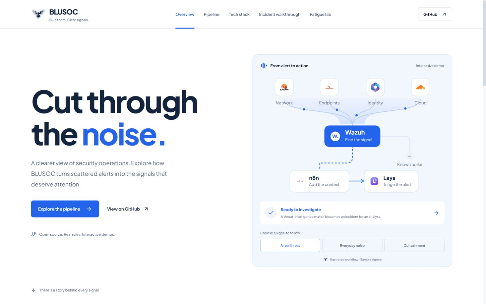

# BLUSOC

**Security operations, made visible.**

An open-source collection of detection rules, Python integrations, deployment tooling, and interactive demos that explain how security alerts become useful signals.

[Explore the code](https://github.com/venkatvellapalem/BLUSOC) · [Architecture](docs/architecture.md) · [Deploy the SOC stack](deployment/README.md) · [Contribute](CONTRIBUTING.md)



## What’s inside

| Component | What you can do |
| --- | --- |
| **Web showcase** | Follow a sample alert, explore the platform directory, inspect an incident, and experiment with noise suppression. |
| **Detection engineering** | Review 15 Wazuh rules and run the accompanying event scenarios. |
| **Integrations** | Transform Wazuh alerts for DFIR-IRIS and monitor IRIS status changes with persistent local state. |
| **Deployment** | Validate configuration, preview a six-step plan, and provision a dedicated Ubuntu server. |

The website illustrates a wider **Wazuh → n8n → Laya → response** workflow. The server scripts provision **Wazuh → Python adapter → DFIR-IRIS**. The n8n, Laya, vendor ingestion, notification, and containment integrations are illustrated separately; they are not installed by the deployment suite.

## Run the website

Use Node.js 24, as specified in [`.nvmrc`](.nvmrc).

```bash
git clone https://github.com/venkatvellapalem/BLUSOC.git
cd BLUSOC
npm ci
npm run dev
```

Open [localhost:3000](http://localhost:3000). The showcase needs **no database, API key, or environment file**.

| Route | Experience |
| --- | --- |
| `/` | A visual introduction to the project |
| `/pipeline` | Interactive detection and response scenarios |
| `/tech-stack` | The platforms and their roles |
| `/workbench` | A read-only incident walkthrough |
| `/fatigue-lab` | An illustrative suppression model |

For a local production build, run `npm run build`, then `npm start`.

## Deploy

**Website:** See [web deployment](docs/web-deployment.md) for Vercel, a Node server, and Docker.

**SOC server:** Use the [deployment guide](deployment/README.md) on a dedicated Ubuntu 22.04 or 24.04 host. Start by generating your private configuration and inspecting the plan:

```bash
python3 deployment/config.py init
python3 deployment/config.py check
bash deployment/deploy.sh --dry-run
```

Review `deployment/.env` before running the privileged provisioning command from the guide. Missing secrets, unsupported hosts, invalid configuration, and failed readiness checks stop the deployment.

## Validate changes

Python 3.10+ and Bash are required in addition to Node. Git for Windows includes Bash. Create and activate a Python virtual environment first; see [development setup](CONTRIBUTING.md#development).

```bash
python -m pip install -r requirements-dev.txt
npm run verify:all
```

This runs linting, TypeScript, dataset consistency checks, rule scenarios, integration tests, deployment tests, documentation checks, the repository audit, and a production web build. CI runs the same checks.

Rule scenarios model matching behavior; they do not replace testing with `wazuh-logtest` on your target manager. Provisioning also runs the actual `wazuh-analysisd -t` check. See [validation scope](docs/architecture.md#validation-boundaries).

## Find your way around

```text
data/                    Sanitized source datasets
detection-engineering/   Wazuh rules, event scenarios, and tuning study
integrations/            IRIS adapter, status monitor, and local mock API
deployment/              Environment tooling, provisioning, and readiness checks
web/                     Next.js showcase and local font assets
docs/                    Architecture, deployment, and incident response
scripts/                 Repository and dataset verification
```

The 67 bundled alert samples use sanitized infrastructure identifiers. Interactive outcomes, animation counters, confidence scores, and fatigue-lab estimates are demonstrations, not live measurements or performance guarantees.

## Contributing

Small, focused improvements are welcome. Read [CONTRIBUTING.md](CONTRIBUTING.md) for local setup and pull request expectations, and [SECURITY.md](SECURITY.md) for reporting security issues.

## License

Project code is licensed under [MIT](LICENSE). Bundled fonts retain their [SIL Open Font License notices](web/src/fonts). Third-party product names and logos belong to their respective owners; their appearance describes the architecture and does not imply affiliation.
