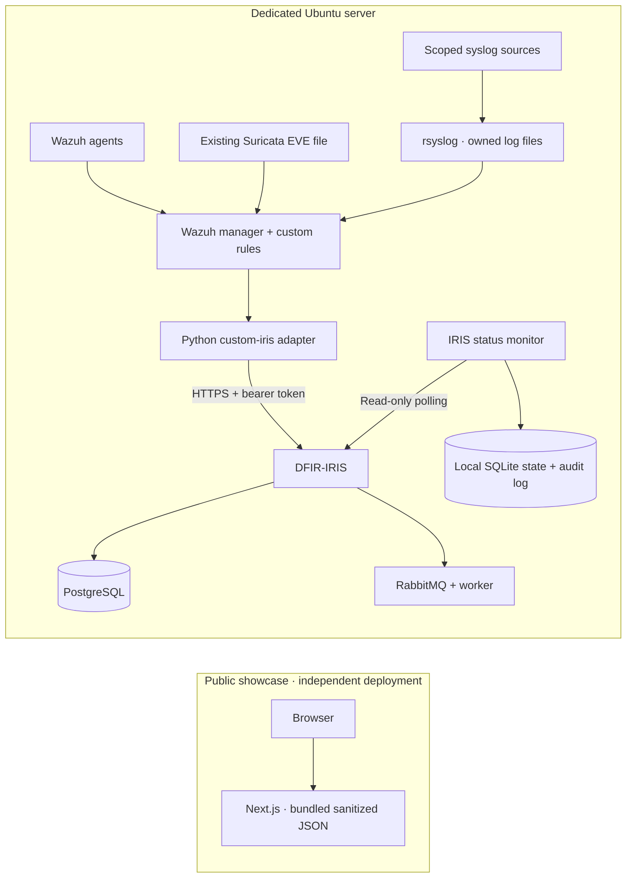

# Architecture

BLUSOC has two deliberately separate runtime boundaries: a public educational showcase and a server-side detection and case-management reference stack.

## What runs today

The website has no route into the server stack. Its incident page reads the bundled dataset, and its simulations execute in the browser. No server credentials belong in the web environment.

## Illustrated reference workflow

The web demos show a broader design: source telemetry → Wazuh qualification → n8n enrichment → Laya triage → IRIS investigation, SOC notifications, or FortiGate containment.

The repository does not provide the n8n workflows, a Laya service, vendor API collectors, or live notification and containment connectors. Adding these requires explicit service contracts, authentication, delivery guarantees, and human approval rules for response actions. The current deployer must not be described as installing that wider workflow.

## Server components

| Component | Responsibility | State |
| --- | --- | --- |
| Wazuh 4.x manager | Collect events and apply the repository rules | `/var/ossec` |
| `custom-iris` | Map severity, classify addresses, and post qualifying alerts | Logs in Wazuh; no invented threat intelligence |
| DFIR-IRIS 2.4 | Maintain alerts, investigations, and case artifacts | Dedicated Docker volumes |
| RabbitMQ + IRIS worker | Process IRIS background jobs | Dedicated broker volume |
| Status monitor | Observe paginated status and owner changes | SQLite baseline plus an audit file |
| rsyslog | Accept explicitly scoped plain syslog input | BLUSOC-owned log files |

The provisioned Wazuh component is the **manager only**. The scripts do not provision a Wazuh indexer, dashboard, HA cluster, or Filebeat pipeline.

## Data and configuration

- `data/` is the source of truth for the sanitized dataset. Run `npm run data:sync` after intentional changes; CI checks the web copy for drift.
- `deployment/.env` is private server configuration. The parser treats values as literal data and rejects duplicates, unknown keys, invalid ports, and unresolved secrets.
- Rendering escapes XML values and writes separate private service environment files. Compose raw env files preserve dollar signs and other literal characters.
- IRIS bootstrap credentials initialize a new database. Editing the environment does not rotate an existing account or database password.
- The adapter keeps up to 4,000 characters of raw log text in its description and reports whether truncation occurred. This does not change Wazuh’s internal buffer.
- Address classification is local. GeoIP and reputation fields remain unknown until a real enrichment provider is connected.

## Trust and network boundaries

IRIS binds to loopback by default. PostgreSQL and RabbitMQ have no published host ports. The private backend network separates those services from the HTTPS proxy.

Agent listeners and the optional remote syslog listener still require explicit host or cloud firewall rules. Plain syslog is intended for a trusted network or protected transport; port 6514 is not advertised as TLS without a TLS listener.

Self-signed IRIS certificates include a subject alternative name and are added to the host trust store. The adapter and monitor use verified HTTPS. For an externally reachable deployment, supply your own certificate and trust chain.

The status monitor runs as a dedicated system user. Its token is supplied through a protected systemd environment file, not a process argument. Its writable paths are limited to its state and audit directories.

The adapter loads its credential and discovered IOC type IDs from a protected runtime file. Wazuh passes a non-secret marker as the integration argument. The adapter uses the configured instance's IDs instead of assuming a database seed order.

## Delivery and recovery

The Wazuh adapter makes one bounded HTTP submission per invocation and exits nonzero on a transport or application error. It does not implement an outbox or guarantee exactly-once delivery. Use Wazuh integration logs and a controlled replay procedure when a destination is unavailable.

The status monitor reads all advertised pages, retries failed polling cycles with capped backoff, and keeps a baseline in SQLite across restarts. Its first observation establishes state; later changes generate audit entries. It does not update Wazuh alerts or the public showcase.

Back up the IRIS database, artifact volumes, private configuration, and certificate material before upgrades. Restoring only the database does not restore attachments. See the [operations guide](../deployment/README.md#operations).

## Validation boundaries

Repository checks cover TypeScript, linting, production builds, dataset consistency, XML structure, modeled rule scenarios, mock HTTP integration, persistent status transitions, environment rendering, shell syntax, and deployment CLI behavior.

These checks do not establish production capacity, detection effectiveness against your event corpus, vendor availability, or a successful installation on your host. Deployment adds real manager configuration tests, container readiness, authenticated IRIS checks, and listener checks. Verify a controlled source event end to end in staging before adopting the stack operationally.
